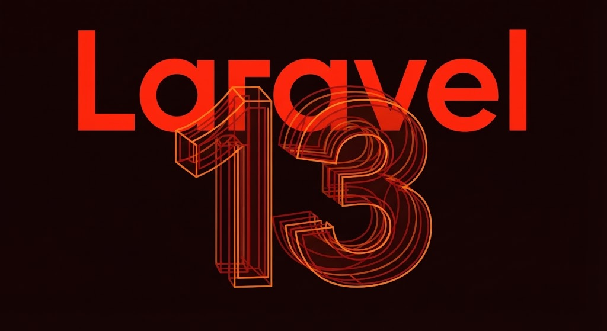

# Curso de Laravel framework código 84255

> Curso de Laravel framework |  
> Martes y Jueves de 19hs a 21:30hs (Arg) |  
> 12 clases desde 01/11/2026 hasta 10/11/2026 |  
> Código: 84255 |  
> sensei: Marcos Pinardi |

1. Definición
2. Requisitos [](https://php.net/) [](https://getcomposer.org/) [](https://laravel.com/) 
3. Chequeo de versiones 
4. Actualización de versiones
5. Creación de proyecto Laravel
6. Iniciar el server 
7. Recursos
8. Creación de proyecto Laravel desde un proyecto existente (clonado)

----
> ☕ Apoyá al profe con un cafecito   
>[](https://cafecito.app/exegeses)
----


## 1. Definición
¿Qué es Laravel?
Laravel es un framework *progresivo* de desarrollo web, de código abierto para PHP, creado por Taylor Otwell. Está diseñado bajo el patrón de arquitectura MVC (Modelo-Vista-Controlador) y su objetivo principal es hacer que el proceso de desarrollo web sea rápido, elegante y agradable para el programador ("The PHP Framework for Web Artisans").

¿Porqué Elegir Laravel?
- [ ] Desarrollo más rápido
- [ ] Menos escritura de código
- [ ] Bibliotecas para tareas comunes
- [ ] Seguir buenas prácticas
- [ ] Más seguro que escribir tus propias Apps
- [ ] Mejor para el trabajo en equipo
- [ ] Fácil de mantener

Laravel se encarga de resolver muchas tareas habituales del desarrollo web, como:

- [ ] Recibir y procesar solicitudes HTTP;
- [ ] Definir rutas;
- [ ] Trabajar con bases de datos;
- [ ] Gestionar usuarios y autenticación;
- [ ] Validar datos;
- [ ] Generar vistas;
- [ ] Gestionar sesiones;
- [ ] Crear APIs y gestionar webhooks

En lugar de construir cada una de estas funcionalidades desde cero, Laravel proporciona herramientas y una estructura organizada para desarrollar aplicaciones de manera más eficiente.

En pocas palabras:
> Laravel es un framework *progresivo* de PHP que proporciona
> una estructura y herramientas para desarrollar aplicaciones web.

## 2. Requisitos de Software
[](https://github.com) 
[](https://php.net/) [](https://getcomposer.org/) [](https://laravel.com/)


1. Terminal de comandos
[](https://github.com)  
- [ ] la del sistema operativo [](https://github.com) [](https://www.apple.com/) [](https://www.debian.org/)
- [ ] Git Bash <https://git-scm.com/> [](https://git-scm.com/)  
- [ ] Ghostty <https://ghostty.org/> [](https://ghostty.org/)  
- [ ] warp <https://www.warp.dev/> [](https://www.warp.dev/)
- [ ] cmDer <https://cmder.net/> [](https://cmder.app/)
- [ ] iTerm2 <https://iterm2.com/> [](https://iterm2.com/)


2. PHP 8.3^ [](https://php.net/)

3. Composer ^2.8  [](https://getcomposer.org/)  
   <https://getcomposer.org/>  
   <https://getcomposer.org/Composer-Setup.exe>
4. Laravel installer ^5.25.0 [](https://laravel.com/) 


PHP >= 8.3 es el requisito principal de versión para Laravel 13.
Composer >= 2.8 es el gestor de dependencias de PHP.
Laravel Installer >= 5.25.0 es una herramienta de línea de comandos que permite crear nuevos proyectos Laravel de manera sencilla.


ℹ️ Opcionalmente NPM (Node Package Manager) es el administrador de paquetes de Node.js y se utiliza en Laravel para instalar y gestionar las dependencias necesarias para el desarrollo frontend.
En escencia para trabajar con Vite, que se encarga de procesar los archivos CSS y JavaScript de la aplicación.

## Chequeo de versiones
En una terminal podemos escribir los siguientes comandos:
```bash
# versión de PHP
php -v
```
```bash
# versión de Composer
composer --version
```
```bash
# versión de Laravel Installer
laravel installer --version
```
```php
# versión de proyecto Laravel (tradicional)
php artisan -V
```
```php
# versión de proyecto Laravel (moderna)
php artisan about 
```

### Actualización de versiones
PHP: dependera de la versión que tengas instalada
- [](https://herd.laravel.com/)
- [](https://php.new/)

Composer: desde una terminal podemos utilizar este comando
```bash
composer self-update
```

Laravel Installer: cuando creemos un proyecto usando *laravel new* el propio instalador chequea versión y, si hay una nueva versión, sugiere la actualización.

----
> ☕ Apoyá al profe con un cafecito   
>[](https://cafecito.app/exegeses)
----

## Creación de proyecto Laravel
Usando un terminal de comandos vamos a movernos al directorio de trabajo    
En ese directorio de trabajo vamos a crear un proyecto (carpeta con toda la magia de laravel).  
Con el comando "cd" nos movemos a nuestro directorio de trabajo
y luego, con el comando "laravel new" crearemos un proyecto

```bash
laravel new nombre-proyecto
```
Una vez finalizada la creaqción de proyecto, nos movemos al directorio creado

```bash
cd nombre-proyecto
```

## Iniciar el server|proyecto laravel
Para iniciar al server usamos el comando
```bash
composer run dev
```

## Recursos (enlaces)
Manual Oficial de Laravel <https://laravel.com/>  
Laravel News <https://laravel-news.com/>  
Laracasts <https://laracasts.com/>  
LaraJobs <https://larajobs.com/> 

----

## Creación de proyecto Laravel desde un proyecto existente (clonado)

1. Primero hay que descargar el proyecto existente usando git preferntemente.   
 Sino, descargar los archivos de manera tradicional.
 Cuando se descarga de este modo, NO DESCARGA TODO EL PROYECTO.  
 NO descarga por ejemplo el directorio "vendor"

> El comando para clonar todo un proyecto desde git es:

    git clone direccion

> Ejemplo:

    git clone https://codeberg.org/exegeses/laravel-84255

2. Una vez descargado, vamos a obtener los componetes necesorios para que funcione el framework  
El comando necesario es "composer update" en el proyecto.  
```bash
composer update
```
No olvidemos primero posicionarnos dentro del directorio del proyecto.
```bash
   cd nombre-proyecto  
   composer update  
```

3. Cuando haya terminado de descargar y querramos iniciar el proyecto, va a parecer que está todo funcionando bien, pero aún falta algo.  
  Al intentar editar el archivo de configuración  ".env" nos damos cuenta que no está- sin embargo, hay un archivo. ".env.example"  
  Entonces vamos a generar nuetro archivo ".env" renombrando o compiando este archivo.

4. Ahora si, el último paso es genear la key del proyecto.  
Esto se logra con el comando
```php
php artisan key:generate
```
5. Configurar la baase de datos.

Ahora si, ya tenemos nuestro proyecto base listo

----
> enjoy coding!  
> ☕ Apoyá al profe con un cafecito   
>[](https://cafecito.app/exegeses)
----